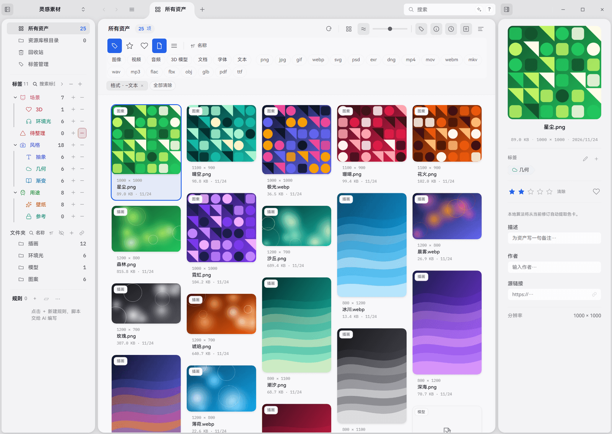
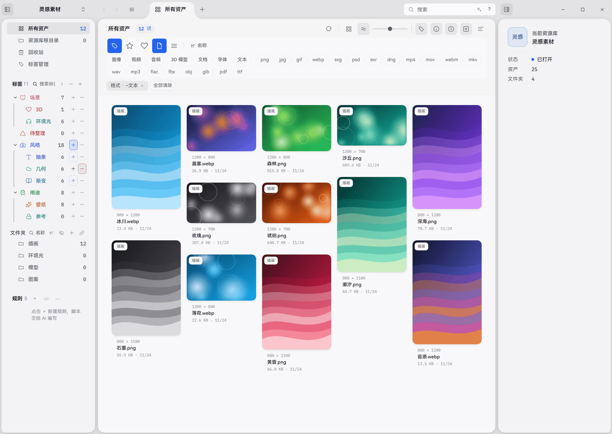

<div align="center">


# Keel

### A local-first library for every kind of file

Gather files scattered across your disks into one library: **find them, see them, keep them in order**, and let rules do the repetitive sorting.

[](https://github.com/Ubik42/Keel/releases)
[](#status)
[](LICENSE)
[](https://www.electronjs.org/)
[](https://react.dev/)

**🇺🇸 English** | [🇨🇳 简体中文](README.md)

[Releases](https://github.com/Ubik42/Keel/releases) · [User guide](docs/user-guide/README.en.md) · [Developer docs](docs/developer/README.en.md) · [Extension manual](docs/manual/README.md)

<br />



</div>

<br />

<table>
<tr>
<td width="33%" valign="top">

### 📂 Your folders are the library

Files stay in your own folder structure, and an existing folder can become a library in place: no copying, no bundles. The database and thumbnails live in `.keel`; companion files move with their main file.

</td>
<td width="33%" valign="top">

### 🧭 Any file type

Built-in previews for images (RAW, EXR and PSD included), video, audio, PDF, fonts, HDR and 3D models. Plugins add thumbnails, metadata and inspector sections for other types.

</td>
<td width="33%" valign="top">

### 🤖 Rules do the sorting

A rule is a TypeScript script stored as a file you can keep in Git. An AI can write one from the guide in the rules folder; rules can be dry-run, every run is recorded, and changes can be undone.

</td>
</tr>
</table>

## ✨ Highlights

- **Hierarchical tags and tag tree filtering**: tags with colors and icons. Each tag row has include and exclude buttons; a parent's state applies to its children unless a child has its own. Save the whole tree as a **preset** and switch with one click.
- **The whole filter in one row**: format groups and common extensions sit right in the filter row, and you pick which ones show from the Format panel. Combine with rating, favorites, color, size and duration.
- **Find by meaning**: an advanced query syntax, plus experimental semantic search that finds images from a sentence or finds similar items.
- **Fast with large libraries**: about 0.9 s from opening a 20,000-item library to the first card; p95 browse navigation about 181 ms.
- **Workspace tabs**: each tab keeps its own place, search and selection; grid and masonry views.
- **AI analysis**: descriptions and tags for images, video and 3D. What you write is stored apart from AI output and is never overwritten.
- **Move in from elsewhere**: open and convert Eagle and Billfish libraries; Serpent libraries migrate automatically.
- **Interfaces for scripts and AI**: a built-in MCP server and a local API over a named pipe (no port), so one script can import and tag in bulk.
- **Sync and capture**: two-way WebDAV sync; a browser extension saves images and video from web pages.
- **Looks good, fits you**: several themes plus custom themes, 75%–200% UI zoom, adjustable font size and corner radius, Chinese and English UI.

<div align="center">

<sub>Tag tree filter: after including “风格” (style), its children follow (dashed); “几何” (geometric) is excluded on its own and overrides the inherited state.</sub>
</div>

## 🧩 Design ideas

1. **A library for every kind of file, not just images.** Specialist programs stay outside and work with Keel as "Open with" targets, for example Panthesia for practising MIDI files.
2. **The files are the library.** Your folder structure stays; data travels with the files.
3. **Rules do the sorting; AI writes the rules.** A rule has one form: a script stored under `.keel/rules/`.
4. **Your decisions come first.** Organizing actions can be undone; risky actions such as permanent deletion ask first.
5. **Local first.** Data stays on your machine, with no account or cloud service; WebDAV when you want several devices.
6. **One program with a clear structure.** Code is layered by domain; dependency direction and style tokens are checked by lint rules.

## 🚀 Getting started

Requires Node.js 24 (see `.nvmrc`). Do not build on an SMB / NAS mount.

```bash
npm ci
npm run rebuild:native   # align better-sqlite3 with the Electron ABI
npm start                # run in development (settings in the project's .local-profile)
npm run package          # package to out/Keel-<platform>-<arch>/
```

On Windows, after packaging, `Start-Keel.exe` in the project root starts Keel without a console. Checks: `npm run lint`, `npm run typecheck`, `npm test`, `npm run test:e2e` (E2E runs in the background without stealing focus). See [Build and packaging](docs/developer/build-packaging.md) for installers and other platforms.

## 📍 Status

- Version 0.4.0 (preview). Daily use and testing happen on **Windows** only; the macOS and Linux build scripts remain but are not verified.
- The releases page currently offers release notes and the browser extension; build the desktop app locally as above.
- Parts of the user guide and its screenshots are still from the Serpent era and will be updated.

## 🗺️ Roadmap

The full plan and progress log are in [docs/进度.md](docs/进度.md).

**Done (since going independent in 2026-11)**

- Renamed to Keel with automatic library migration; removed collections, smart collections, upstream auto-update and the online plugin catalog.
- Added a file-type plugin interface, per-type "Open with", companion files, the rule system, hierarchical tags and tag appearance, tag tree include/exclude filtering with presets, the root library layout and in-place adoption, and the local API.
- Refactoring: zustand state and components in the renderer (`App.tsx` from 17,673 lines to 17); the backend split by domain (`library-service.ts` from 52,331 lines to 686); styles turned into tokens checked by Stylelint.
- Performance: first card in a 20,000-item library from 15.9 s to 0.9 s; p95 browse navigation from 2,454 ms to 181 ms.

**Planned**

- Finish the design tokens: line heights and control sizes that follow the font size.
- Panthesia integration: MIDI / MusicXML metadata, piano-roll thumbnails and "Practise in Panthesia".
- Windows installer and portable build on the releases page; rewrite the user guide and screenshots.

**Not planned**

A visual rule editor or other rule forms, in-app auto-update and an online plugin catalog, mobile apps, accounts and cloud services, splitting into several npm packages. Native rewrites for performance only if measurement shows JS computation is the bottleneck (2026-11 measurements put it in process creation and disk writes).

## 🛠️ Technology

| Layer | Choice |
| --- | --- |
| Desktop shell | Electron 43, electron-forge with Vite 8 multi-entry builds |
| UI | React 19, zustand, TypeScript 6; styles use only the tokens in `tokens.css` |
| Data | One SQLite database per library (better-sqlite3), FTS5 trigram search, sqlite-vec vectors; migrations only add |
| Media | sharp, FFmpeg / ffprobe, OpenImageIO, pdf.js, ufbx (WASM) and three.js |
| Extensions | Plugins with declared permissions (standard and trusted hosts); scripts and rules run in a QuickJS sandbox through the automation gateway, sharing validation and undo with the UI; built-in MCP and local API |
| Quality | ESLint (with dependency-direction rules), Stylelint (token rules), vitest, Playwright E2E |

The main process owns windows, protocols, plugin and rule scheduling and MCP; the Library Worker owns SQLite and the file system (import, scan, search, thumbnails); the renderer only draws the UI. See [Architecture](docs/developer/architecture.md).

## 📚 Documentation

| Document | Contents |
| --- | --- |
| [User guide](docs/user-guide/README.en.md) | Install, import, browse, search, sync, AI, plugins, automation, troubleshooting |
| [What Keel adds](README.local.md) | Root layout, in-place adoption, hierarchical tags, tag appearance (Chinese) |
| [Developer docs](docs/developer/README.en.md) | Setup, architecture, testing, build and packaging |
| [Extension manual](docs/manual/README.md) | Plugins, scripts, MCP, [local API](docs/manual/mcp/local-api.md) |
| [Plan and progress](docs/进度.md) | Long-term plan, stages, decisions and progress (Chinese) |

## 🙏 Thanks

Keel comes from **[Serpent](https://github.com/dolag233/Serpent)**, the open-source digital asset manager by dolag233 and the Serpent contributors (MIT). The library, the import and preview pipelines, and the plugin and automation frameworks all come from Serpent; thank you. Since 2026-11-21 Keel is developed on its own and no longer merges upstream; most features will be redone along Keel's own design ideas. Serpent libraries open directly in Keel (`.serpent` is migrated to `.keel`; Serpent cannot open them afterwards).

The sample images in the README screenshots are generated by a script; the environment-light previews come from [Poly Haven](https://polyhaven.com/) (CC0).

## 📄 License

MIT, see [LICENSE](LICENSE): the original Serpent contributors' copyright notice is kept and Keel's copyright line is added. Bundled media components and assets follow their own licenses (FFmpeg LGPL, OpenImageIO, ufbx MIT, Poly Haven CC0); see [THIRD_PARTY_NOTICES.md](THIRD_PARTY_NOTICES.md) and the LICENSE files under `resources/`.
