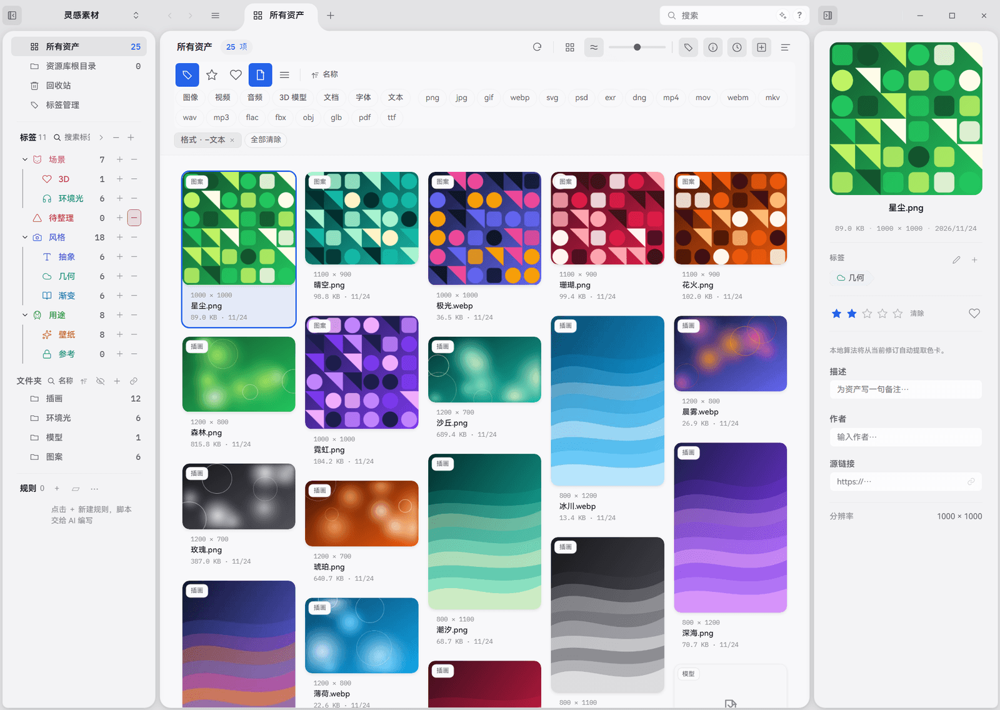
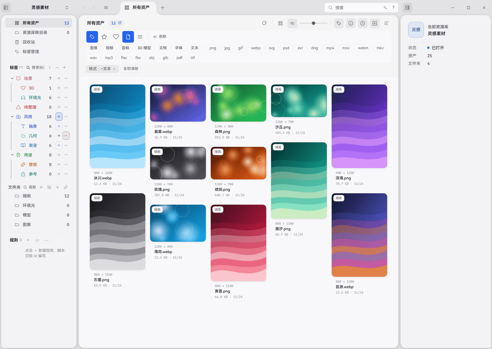

<div align="center">


# Keel

### 本地优先的通用文件库

把散落在各处的文件收进一个资源库：**找得到、看得见、理得清**，重复的整理交给规则。

[](https://github.com/Ubik42/Keel/releases)
[](#当前状态)
[](LICENSE)
[](https://www.electronjs.org/)
[](https://react.dev/)

**🇨🇳 简体中文** | [🇺🇸 English](README.en.md)

[发布页](https://github.com/Ubik42/Keel/releases) · [使用手册](docs/user-guide/README.md) · [开发者文档](docs/developer/README.md) · [扩展作者手册](docs/manual/README.md)

<br />



</div>

<br />

<table>
<tr>
<td width="33%" valign="top">

### 📂 文件就是资源库

素材直接放在你自己的文件夹里，已有目录可以原位变成资源库，不复制、不打包。数据库与缩略图集中在 `.keel`，伴生文件随主文件移动。

</td>
<td width="33%" valign="top">

### 🧭 什么文件都能管

图片（含 RAW、EXR、PSD）、视频、音频、PDF、字体、HDR 与 3D 模型都有内置预览；其他类型由插件提供缩略图、元数据与检查器。

</td>
<td width="33%" valign="top">

### 🤖 规则替你整理

规则是一份 TypeScript 脚本，存成文件、可放进 Git。AI 读规则目录里的说明就能写；运行前可试运行，每次运行都有记录，可以撤销。

</td>
</tr>
</table>

## ✨ 亮点

- **层级标签与标签树过滤**：每个标签可设颜色和图标。标签行尾有"加入 / 排除"两个按钮，父标签的状态自动作用于子标签，子标签也可以单独设置。整棵树的状态可以存成**预设**，一键切换。
- **一行看全的过滤**：格式分组与常用扩展名直接排在过滤行上，哪些显示在外面可以在"格式"面板里逐项钉上或取下；评分、喜欢、颜色、尺寸、时长都能组合过滤。
- **按含义找图**：高级搜索语法；实验性的语义搜索可以用一句话描述来找图，或查找相似素材。
- **流畅的大库**：打开 2 万素材的资源库到出现第一张卡片约 0.9 秒，浏览跳转 p95 约 181 ms。
- **多标签页工作区**：每个标签页各自保留位置、搜索和选择；平铺与瀑布流两种视图。
- **AI 分析**：为图片、视频和 3D 素材生成描述与标签；人工填写的内容与 AI 内容分开保存，AI 不会覆盖。
- **从别处搬家**：直接打开 Eagle、Billfish 资源库并转换；Serpent 资源库自动迁移。
- **给脚本和 AI 的接口**：内嵌 MCP 服务；本机 API 走命名管道，不占端口，一个脚本就能批量导入、打标签。
- **同步与采集**：WebDAV 双向同步；浏览器扩展把网页上的图片和视频存进资源库。
- **好看也好用**：多套主题与自定义主题，界面缩放 75%–200%，字体大小和圆角可调，简体中文与英文界面。

<div align="center">

<sub>标签树过滤：“风格”加入后，子标签自动跟随（虚线）；“几何”单独设为排除，覆盖继承的状态。</sub>
</div>

## 🧩 设计理念

1. **通用文件库，不只是图片库。** 专用软件不并入 Keel，而是作为外部的"打开方式"配合，例如 MIDI 文件交给 Panthesia 练习。
2. **文件就是资源库。** 保留你的文件夹结构；数据跟着文件走。
3. **整理交给规则，规则交给 AI。** 规则只有脚本一种形态，以文件保存在 `.keel/rules/`。
4. **人的决定优先。** 整理操作都能撤销；永久删除等高风险操作需要确认。
5. **本地优先。** 数据在本机，不需要账号和云服务；需要多设备时用 WebDAV。
6. **一个软件，结构清楚。** 代码按领域分层，依赖方向和样式 token 由 lint 检查。

## 🚀 快速开始

要求 Node.js 24（见 `.nvmrc`），不要在 SMB / NAS 挂载目录上构建。

```bash
npm ci
npm run rebuild:native   # 对齐 better-sqlite3 与 Electron ABI
npm start                # 开发运行（配置保存在工程的 .local-profile）
npm run package          # 打包到 out/Keel-<平台>-<架构>/
```

Windows 上打包后，可以用工程根目录的 `Start-Keel.exe` 无控制台启动。常用检查：`npm run lint`、`npm run typecheck`、`npm test`、`npm run test:e2e`（E2E 在后台运行，不弹窗、不抢焦点）。打包与多平台说明见 [构建与打包](docs/developer/build-packaging.md)。

## 📍 当前状态

- 版本 0.4.0（预发布）。日常使用与测试只在 **Windows** 上进行；macOS 和 Linux 的构建脚本保留，但没有验证。
- 发布页目前提供版本说明和浏览器扩展，桌面程序需按上面的步骤本地打包。
- 使用手册的部分章节和截图仍是 Serpent 时期的内容，会逐步更新。

## 🗺️ 路线

完整计划与进度见 [docs/进度.md](docs/进度.md)。

**已完成（2026-11 独立以来）**

- 改名为 Keel，自动迁移旧资源库；删除合集、智能合集、上游自动更新和在线插件目录。
- 新增文件类型插件接口、按类型的打开方式、伴生文件、规则系统、层级标签与外观、标签树加入 / 排除过滤与预设、根目录布局与原位接管、本机 API。
- 重构：渲染层改用 zustand 并组件化（`App.tsx` 从 17,673 行降到 17 行）；后端按领域拆分（`library-service.ts` 从 52,331 行降到 686 行）；样式整理为 token 并由 Stylelint 约束。
- 性能：2 万素材资源库首屏从 15.9 秒降到 0.9 秒；浏览跳转 p95 从 2,454 ms 降到 181 ms。

**计划中**

- 设计 token 收尾：行高与控件尺寸随字号变化。
- 与 Panthesia 配合：MIDI / MusicXML 元数据、钢琴卷帘缩略图与"用 Panthesia 练习"。
- 在发布页提供 Windows 安装包与便携版；按现状重写使用手册和截图。

**不打算做**

可视化规则编辑器及其他规则形态、应用内自动更新与在线插件目录、移动端与账号云服务、拆成多个 npm 包；为性能改写成原生模块只在测量证明 JS 计算是瓶颈时才考虑（2026-11 实测瓶颈在进程创建与磁盘写入）。

## 🛠️ 技术路线

| 层 | 选择 |
| --- | --- |
| 桌面外壳 | Electron 43，electron-forge 与 Vite 8 多入口构建 |
| 界面 | React 19、zustand、TypeScript 6；样式只引用 `tokens.css` 中的 token |
| 数据 | 每个资源库一个 SQLite（better-sqlite3），FTS5 trigram 全文检索，sqlite-vec 向量检索；迁移只增不改 |
| 媒体 | sharp、FFmpeg / ffprobe、OpenImageIO、pdf.js、ufbx（WASM）与 three.js |
| 扩展 | 声明权限的插件（标准 / 受信两种宿主）；脚本与规则运行在 QuickJS 沙箱，经自动化网关调用，与界面操作共用校验与撤销；内嵌 MCP 与本机 API |
| 质量 | ESLint（含依赖方向规则）、Stylelint（token 规则）、vitest、Playwright E2E |

主进程负责窗口、协议、插件与规则调度和 MCP；Library Worker 独占 SQLite 与文件系统，负责导入、扫描、搜索和缩略图；渲染进程只负责界面。详见 [架构说明](docs/developer/architecture.md)。

## 📚 文档

| 文档 | 内容 |
| --- | --- |
| [使用手册](docs/user-guide/README.md) | 安装、导入、浏览、搜索、同步、AI、插件、自动化、故障排查 |
| [Keel 新增功能说明](README.local.md) | 根目录布局、原位接管、层级标签、标签外观等 |
| [开发者文档](docs/developer/README.md) | 环境搭建、架构、测试、构建打包 |
| [扩展作者手册](docs/manual/README.md) | 插件、脚本、MCP、[本机 API](docs/manual/mcp/local-api.md) |
| [计划与进度](docs/进度.md) | 长期计划、阶段、决定和进度记录 |

## 🙏 致谢

Keel 源自 dolag233 与贡献者开发的开源数字资产管理软件 **[Serpent](https://github.com/dolag233/Serpent)**（MIT）。资源库、导入与预览管线、插件和自动化框架等基础都来自 Serpent，在此致谢。2026-11-21 起 Keel 独立开发，不再合并上游，会按自己的设计理念逐步重做大部分功能；Serpent 资源库可以直接在 Keel 中打开（`.serpent` 自动迁移为 `.keel`，迁移后不能再用 Serpent 打开）。

README 截图中的示例图由脚本生成；环境光预览来自 [Poly Haven](https://polyhaven.com/)（CC0）。

## 📄 许可证

MIT，见 [LICENSE](LICENSE)：保留 Serpent contributors 的原版权声明，并加上 Keel 的版权行。内置媒体组件与资源遵循各自的许可（FFmpeg LGPL、OpenImageIO、ufbx MIT、Poly Haven CC0），见 [THIRD_PARTY_NOTICES.md](THIRD_PARTY_NOTICES.md) 与 `resources/` 下的 LICENSE 文件。
