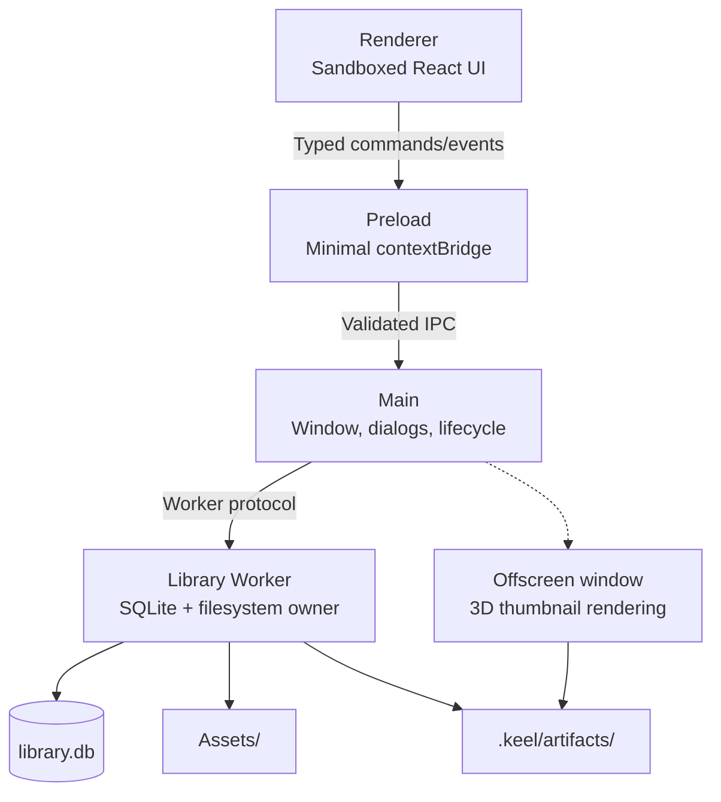

# Architecture

## Process model

```
Renderer (sandboxed, no Node)
  │ typed commands/events only
  ▼
Preload (minimal bridge, contextIsolation)
  ▼
Main (window + dialogs + process lifecycle)
  ▼
Library Worker (UtilityProcess; filesystem + SQLite owner)
```



Invariants:

- The Renderer never gets arbitrary path or SQL capabilities
- Main never opens the library database or scans asset directories
- The Library Worker is the sole owner of the database and file operations
- All cross-process I/O is validated with Zod at runtime

A hidden offscreen window (owned by Main) renders 3D model thumbnails.

## Tech stack

Electron + TypeScript + SQLite (better-sqlite3, FTS5) + Vite + React. Packaging via electron-forge + Vite multi-entry (main / preload / offscreen / worker / script runtimes).

## Directory layout

```
src/
├── main/                 # Electron main; the root holds only entry.ts, index.ts (startup wiring), main-state.ts
│   ├── app/              # logging, icons, startup and generic file helpers
│   ├── window/           # main window, menus, dialogs, confirmation windows, Windows/Linux window details
│   ├── library/          # library IPC, worker client, keel:// protocol, recent libraries, sync scheduling
│   ├── library-request/  # renderer requests by domain
│   ├── commands/         # Gateway commands mapped to worker requests
│   ├── ingestion/        # browser-extension server, web and desktop imports
│   ├── media/            # preview caches, offscreen thumbnail rendering, media binary environment
│   ├── shell/            # open-with, clipboard, native drag
│   ├── automation/       # rule runner, script IPC, execution journal
│   ├── mcp/              # embedded MCP server, credentials and permissions
│   ├── plugins/          # plugin packages, runtime supervisors, activation
│   ├── ai/ embedding/    # AI analysis queue and settings; semantic search service
│   └── preferences/      # preference files and IPC
├── preload/              # contextBridge
├── renderer/             # React renderer; the root holds only main.tsx and App.tsx
│   ├── app/              # shell wiring: hooks for shell, library, browse, organize, preview, workspace, ai
│   ├── workbench/        # domain-free building blocks: ui (tokens and controls), overlay, menu, tree, selection, shortcuts, collection …
│   ├── stores/           # zustand state
│   ├── browse/ viewer/ inspector/ filters/ search/ tags/ folders/ trash/ import/ library/
│   ├── rules/ plugins/ ai/ jobs/ settings/ theme/ appearance/ context-menus/ workspace/ shell/ common/
│   ├── 3d-viewer/        # three.js model viewer
│   ├── i18n/             # Chinese and English strings
│   └── styles/           # styles by area (fonts/ included)
├── worker/               # Library Worker
│   ├── index.ts          # startup and command dispatch; worker-runtime.ts holds runtime state and media scheduling
│   ├── handlers/         # command handlers by domain
│   ├── library-service.ts# the LibraryService class (state and constructor); methods live in the *-methods.ts modules
│   ├── library/          # library methods, database types (database.ts), schema SQL and migration list (schema-sql.ts), migration runner (migrations.ts), file helpers, shared types
│   ├── media/            # thumbnails, previews, proxies, media child processes and decoder concurrency
│   └── integrations/     # AI, sync, Eagle/Billfish
├── scripting/            # script runtime and plugin hosts
├── plugins/ mcp/ automation/  # plugin SDK and manifest, MCP tool catalog, automation Gateway
└── shared/               # cross-process: protocols, types, validation schemas
config/vite/              # Vite configs per build target (shared by forge and the E2E build)
scripts/                  # build, media, packaging, release and benchmark scripts
resources/                # runtime resources (media binaries, ufbx WASM, icons)
tests/
├── unit/                 # pure unit tests (Node ABI), split into main/, renderer/, shared/ …
├── worker/               # worker integration tests (Electron ABI)
└── e2e/                  # Playwright E2E (dev and packaged)
docs/                     # documentation; docs/进度.md holds the plan and progress
```

## Data layer

- Each library is one SQLite database (`.keel/library.db`) with versioned schema migrations (`MIGRATIONS` in `worker/library/schema-sql.ts`)
- New libraries keep assets directly in the library root by default, or in an `Assets/` subfolder (`.keel/storage-layout.json`); derived data (thumbnails/proxies) in `.keel/artifacts/`
- **Data-compatibility discipline**: migrations are add-only (no dropping/renaming existing tables, columns, indexes or triggers); new builds must open old libraries (lenient reads — missing columns degrade to defaults, never crash); Desktop does not offer read-only libraries — damage is repaired from backups then Assets rescue. Library availability is the hardest baseline: any library-related change must fully run `npm run test:library-availability`. See [ADR-0028](https://github.com/dolag233/Serpent/blob/dolag_dev/docs/internal/adr/0028-schema-compatibility-read-only-degrade.md) and [0031](https://github.com/dolag233/Serpent/blob/dolag_dev/docs/internal/implementation/0031-schema-compatibility-guarantee.md)

## Media pipeline

- Thumbnails / video proxies / audio proxies: Worker queues → Main/child processes (FFmpeg/OIIO) → written back to artifacts
- FBX: ufbx WASM conversion → GLB (cached) → rendered via GLTFLoader
- 3D thumbnails: Worker queues → Main offscreen window renders → PNG written back

## Extension system

Plugins (sandboxed UI + Host API), automation scripts (isolated QuickJS), and MCP (Desktop-embedded loopback Streamable HTTP) — see the [extension author manual](../manual/README.md).

## Key design decisions

- Process isolation and least privilege: no Node in the Renderer, Main never touches the database
- Data compatibility is a release-level gate (Serpent-033e / ADR-0028 / 0031)
- Native-platform builds only (no cross-packaging); the release pipeline carries end-to-end gates
