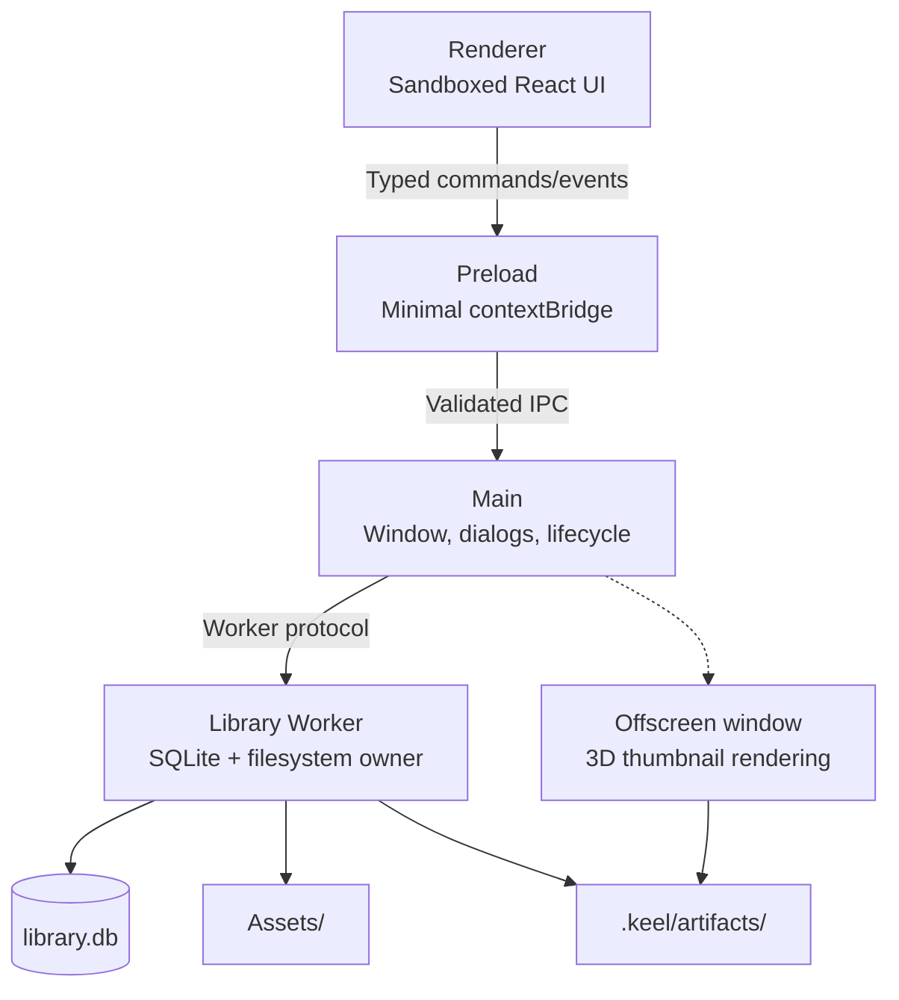

# 架构

## 进程模型

```
Renderer (sandboxed, no Node)
  │ typed commands/events only
  ▼
Preload (minimal bridge, contextIsolation)
  ▼
Main (window + dialogs + process lifecycle)
  ▼
Library Worker (UtilityProcess; filesystem + SQLite owner)
```



不变量：

- Renderer 永远不接收任意路径读写或 SQL 能力
- Main 不打开资源库数据库、不扫描资产目录
- Library Worker 是数据库与文件操作的唯一所有者
- 所有跨进程 I/O 经 Zod 运行时校验

另有一个隐藏 offscreen 窗口（Main 持有），用于 3D 模型缩略图离屏渲染。

## 技术栈

Electron + TypeScript + SQLite（better-sqlite3，FTS5）+ Vite + React。构建用 electron-forge + Vite 多入口（main / preload / offscreen / worker / 脚本运行时）。

## 目录结构

```
src/
├── main/                 # Electron 主进程；根目录只有 entry.ts、index.ts（启动装配）、main-state.ts
│   ├── app/              # 日志、图标、启动与通用文件工具
│   ├── window/           # 主窗口、菜单、对话框、确认窗口、Windows/Linux 窗口细节
│   ├── library/          # 资源库 IPC、Worker 客户端、keel:// 协议、最近资源库、同步调度
│   ├── library-request/  # 渲染进程请求的分领域处理
│   ├── commands/         # Gateway 命令到 Worker 请求的适配
│   ├── ingestion/        # 浏览器扩展服务、网页与桌面导入
│   ├── media/            # 预览缓存、离屏缩略图渲染、媒体二进制环境
│   ├── shell/            # 打开方式、剪贴板、原生拖动
│   ├── automation/       # 规则运行器、脚本 IPC、执行日志
│   ├── mcp/              # 内嵌 MCP 服务、凭据与权限
│   ├── plugins/          # 插件包管理、运行时监管、激活
│   ├── ai/ embedding/    # AI 分析队列与配置；语义搜索服务
│   └── preferences/      # 偏好文件与 IPC
├── preload/              # contextBridge 桥
├── renderer/             # React 渲染器；根目录只有 main.tsx 与 App.tsx
│   ├── app/              # 外壳装配：shell、library、browse、organize、preview、workspace、ai 各领域 hook
│   ├── workbench/        # 与业务无关的基础件：ui（token 与基础控件）、overlay、menu、tree、selection、shortcuts、collection 等
│   ├── stores/           # zustand 状态
│   ├── browse/ viewer/ inspector/ filters/ search/ tags/ folders/ trash/ import/ library/
│   ├── rules/ plugins/ ai/ jobs/ settings/ theme/ appearance/ context-menus/ workspace/ shell/ common/
│   ├── 3d-viewer/        # three.js 模型查看器
│   ├── i18n/             # 中英文文案
│   └── styles/           # 按区域划分的样式（含 fonts/）
├── worker/               # Library Worker
│   ├── index.ts          # 启动与命令分派；worker-runtime.ts 为运行时状态与媒体调度
│   ├── handlers/         # 按领域的命令处理
│   ├── library-service.ts# LibraryService 类（状态与构造）；方法装在各 *-methods.ts
│   ├── library/          # 资源库方法、数据库类型（database.ts）、结构 SQL 与迁移表（schema-sql.ts）、迁移执行（migrations.ts）、文件工具、共享类型
│   ├── media/            # 缩略图、预览、代理、媒体子进程与解码并发
│   └── integrations/     # AI、同步、Eagle/Billfish
├── scripting/            # 脚本运行时与插件 Host
├── plugins/ mcp/ automation/  # 插件 SDK 与清单、MCP 工具目录、自动化 Gateway
└── shared/               # 跨进程共享：协议、类型、校验 schema
config/vite/              # 各构建目标的 Vite 配置（forge 与 E2E 构建共用）
scripts/                  # 构建、媒体、打包、发布、基准脚本
resources/                # 运行时资源（媒体二进制、ufbx WASM、图标）
tests/
├── unit/                 # 纯单元测试（Node ABI），按 main/、renderer/、shared/ 等分目录
├── worker/               # Worker 集成测试（Electron ABI）
└── e2e/                  # Playwright E2E（dev 与 packaged）
docs/                     # 文档；docs/进度.md 为计划与进度
```

## 数据层

- 每个资源库一个 SQLite 数据库（`.keel/library.db`），schema 版本化迁移（`worker/library/schema-sql.ts` 的 `MIGRATIONS`）
- 新建资源库的素材默认直接放在根目录，也可选 `Assets/` 子目录（`.keel/storage-layout.json`），派生数据（缩略图/代理）存 `.keel/artifacts/`
- **数据兼容纪律**：迁移只加不改（禁删改现有表/列/索引/触发器）；新代码必须能打开旧库（宽容读取：缺列降级默认值，不崩溃）；Desktop 不提供只读资源库，损坏走备份再 Assets 抢救。资源库可用性是项目最重要底线，相关改动必须完整跑完 `npm run test:library-availability`。见 [ADR-0028](https://github.com/dolag233/Serpent/blob/dolag_dev/docs/internal/adr/0028-schema-compatibility-read-only-degrade.md) 与 [0031](https://github.com/dolag233/Serpent/blob/dolag_dev/docs/internal/implementation/0031-schema-compatibility-guarantee.md)

## 媒体管线

- 缩略图/视频代理/音频代理：Worker 排队 → Main/子进程处理（FFmpeg/OIIO）→ 写回 artifacts
- FBX：ufbx WASM 转换 → GLB（缓存）→ GLTFLoader 渲染
- 3D 缩略图：Worker 入队 → Main offscreen 窗口渲染 → PNG 写回

## 扩展体系

- 插件（sandboxed UI + Host API）、自动化脚本（QuickJS 隔离）、MCP（Desktop 内嵌 loopback Streamable HTTP）——详见[扩展作者手册](../manual/README.md)

## 关键设计决策

- 进程隔离与最小权限：Renderer 无 Node、Main 不碰数据库
- 数据兼容为发布级门禁（Serpent-033e / ADR-0028 / 0031）
- 平台原生构建（无交叉打包），发布流水线带全链路门禁
